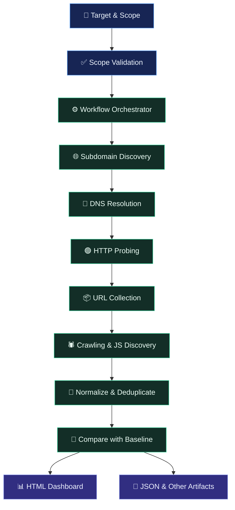

# ⚡ ReconFlow
### The Signal-Focused Reconnaissance Orchestrator

**One target. One workflow. A clearer view of your attack surface.**

ReconFlow is a Go-based reconnaissance orchestrator designed to organize external recon tools into a structured, dependency-aware workflow. It helps you collect assets, track discoveries, compare runs, and generate a self-contained HTML report.

> 🚧 **Early development — v0.1.0**
>
> Automated tests currently use mock tools. Real-tool compatibility and runtime behavior on Kali Linux have not yet been fully validated.

---

## 🚀 Why ReconFlow?

- ⚙️ **Automated Workflow** — Run reconnaissance stages in dependency order.
- 🎯 **Scope-Aware** — Validate target scope before execution.
- 🔄 **Change Tracking** — Compare discoveries across runs.
- 🧠 **Evidence & Provenance** — Keep track of where observations came from.
- 🧩 **JavaScript Intelligence** — Organize JavaScript-related discoveries for further analysis.
- 📊 **Interactive Reports** — Review results through a standalone HTML dashboard.
- ⏯️ **Execution Management** — Inspect run status and resume supported interrupted runs.

---

## 🗺️ How It Works

ReconFlow coordinates the workflow rather than replacing the underlying tools.



---

## 🛠️ Integrated Tools

ReconFlow orchestrates external tools; each must be installed and compatible with the relevant workflow stage.

| Tool | Purpose |
|---|---|
| [Subfinder](https://github.com/projectdiscovery/subfinder) | Subdomain discovery |
| [dnsx](https://github.com/projectdiscovery/dnsx) | DNS resolution |
| [httpx](https://github.com/projectdiscovery/httpx) | HTTP probing and metadata |
| [gau](https://github.com/lc/gau) | Historical URL collection |
| [waybackurls](https://github.com/tomnomnom/waybackurls) | Wayback Machine URL collection |
| [Katana](https://github.com/projectdiscovery/katana) | Web crawling |

*Actual execution depends on the configured pipeline, installed binaries, and their availability.*

---

## 📥 Installation

**Requirements**
- Linux environment — Kali Linux is the intended target.
- Go `1.27.0+`, as declared by the project.
- Git and the external tools required by your selected workflow.

### 1. Clone the repository

```bash
git clone https://github.com/AboudAdmin/reconflow.git
cd reconflow
```

### 2. Install

```bash
chmod +x install.sh
./install.sh
```

If the repository is already on your machine, skip the clone step. The installer is intended for Linux environments.

### 3. Build from source

```bash
go build -o reconflow ./cmd/reconflow
```

> **Note:** Confirm the installer and required tool versions on your system before running a real engagement.

---

## ⚡ Quick Start

Check the available options first:

```bash
./reconflow --help
```

Validate the target scope:

```bash
./reconflow validate-scope
```

Run a passive workflow:

```bash
./reconflow --passive
```

Start a fresh run:

```bash
./reconflow --new
```

Generate a report:

```bash
./reconflow report
```

**Important:** These commands illustrate the intended CLI workflow. Check `--help` and the project configuration for the exact arguments required by your current build.

---

## 📊 Results & Dashboard

Per target, under `<data_dir>/targets/<target>/`:

```
normalized/          clean, deduplicated lists from the newest run (stable path for scripts)
runs/<run-id>/
  raw/               untouched tool output + <stage>.meta.json (exit code, stderr, filter counts, per-host crawl record)
  inputs/            exactly what each tool was fed
  normalized/        the same lists for THIS run, with manifest.json (SHA-256, completeness, per-stage status)
  report.json        full report for this run (history stays readable)
reports/latest.html  React dashboard (single file, works offline)
```

| Normalized file | Content |
|---|---|
| `subdomains.txt`, `live_hosts.txt/.jsonl` | In-scope subdomains; live services with status, title, tech |
| `urls.txt`, `urls_priority.tsv` | Kept URLs; score-ranked subset worth looking at first |
| `js_files.txt`, `api_endpoints.txt/.jsonl` | JavaScript URLs; API URLs plus API paths found in JS (unverified) |
| `findings.jsonl/.md` | Leads ranked high/medium/low. **Leads are pointers, never confirmed vulnerabilities.** |
| `manifest.json` | `complete: false` whenever any stage did not succeed |

**Noise handling.** Static resources, `?id=1..N` / `/user/123` variants beyond `limits.max_urls_per_shape`, and
duplicates are counted but kept out of the lists. They are never lost: raw evidence keeps every line, and the dashboard and
stage detail show how many were filtered.

**Crawling.** `katana` runs once per live host with its own budget (`crawl.host_budget`, `crawl.parallel`). Hosts that hit
the budget, failed, or never started are named in the stage detail and make the stage `partial` (never silently complete).

The dashboard (`dashboard/`, React + Vite, built into one HTML file and embedded in the binary) has Overview, Leads, Hosts,
Subdomains, Endpoints, JavaScript, Changes, Runs and Pipeline views with search, filters, sorting and detail drawers.
Rebuild it with `make dashboard` (needs Node; the built file is committed).

---

## 🧰 Useful Commands

| Option / Command | Purpose |
|---|---|
| `--help` | Display CLI usage |
| `tools` | Inspect tool-related information |
| `validate-scope` | Validate configured scope |
| `--passive` | Select passive workflow mode |
| `--new` | Start a fresh run |
| `--all` | Select the full workflow |
| `--status` | Inspect execution status |
| `--resume` | Resume a supported run |
| `report` | Generate a report |

Refer to the current CLI help for required arguments and supported combinations.

---

## 🛡️ Scope & Responsible Use

ReconFlow is intended for authorized security research.

- ✅ Validate the permitted targets before running.
- 🔒 Follow the configured scope restrictions.
- 🚫 Exclusions take precedence over inclusions.
- 🧭 Discovering an asset does not automatically authorize testing it.
- ⚠️ External tools may perform their own DNS requests and network activity.
- 🔎 Treat collected indicators as leads for investigation, not confirmed vulnerabilities.

**Only run reconnaissance against systems you own or have explicit permission to assess.**

---

## 🧪 Project Status

ReconFlow is under active development.

| Area | Current status |
|---|---|
| Workflow orchestration | Implemented; integration validation remains |
| Automated testing | Mock-tool tests |
| Real external-tool compatibility | Not fully validated |
| Kali Linux runtime | Not yet fully validated |
| HTML dashboard | Implemented; real-run validation remains |
| Vulnerability verification | Not a substitute for manual validation |

ReconFlow is a reconnaissance workflow manager, **not a guarantee of vulnerability discovery**. Port scanning, TLS analysis, and vulnerability scanning should not be assumed unless explicitly implemented and configured.

---

## 👨‍💻 Development

Useful project checks:

```bash
make fmt
make vet
make test
make build
```

For implementation details, architecture, and technical decisions, see [`docs/IMPLEMENTATION.md`](docs/IMPLEMENTATION.md).

---

## 📄 License

Check the repository for its `LICENSE` file before redistributing or reusing the project. If no license is present, usage and redistribution permissions should not be assumed.

---

<div align="center">

**⚡ ReconFlow**

*Less noise. Better visibility. More structured reconnaissance.*

Built for a more organized bug bounty workflow.

</div>
