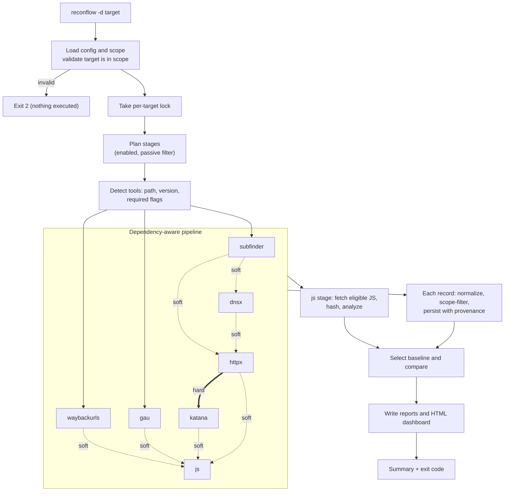

# ReconFlow

**A dependency-aware orchestrator for authorized reconnaissance.** ReconFlow runs well-known reconnaissance tools (`subfinder`, `dnsx`, `httpx`, `gau`, `waybackurls`, `katana`) in the right order, enforces an explicit scope on everything they return, stores every observation with its provenance in SQLite, compares each run against a trustworthy baseline, analyzes in-scope JavaScript, and writes JSON/JSONL/text reports plus a self-contained offline HTML dashboard.

> **Authorized use only.** Run ReconFlow only against assets you own or have explicit written permission to test. It performs no exploitation, but it does send traffic (DNS, HTTP, crawling, JavaScript downloads) and queries third-party data sources. You are responsible for your scope file and for the targets you name.

> **Project maturity: early (version 0.1.0).** The code is implemented and covered by automated tests that use *mock* tools. It has **not** been run against real installed tool versions, on a real Linux/Kali host, or against a real target. See [Testing and validation status](#15-testing-limitations-and-roadmap). Treat the first runs as a trial: start with `reconflow tools`, then a small passive run on a domain you own.

## Quick start

Run from the repository root on Linux (Go required, see [Installation](#5-installation-and-prerequisites)):

```bash
./install.sh                       # builds and installs to ~/.local/bin/reconflow
reconflow tools                    # which external tools are usable?
reconflow validate-scope --scope configs/scope.example.yaml -d example.com
reconflow -d example.com --scope configs/scope.example.yaml --passive   # replace example.com!
```

Reports are written to `~/.reconflow/targets/<target>/reports/`; open `latest.html` in a browser. Full walkthrough: [Quick start](#6-quick-start).

---

## Table of contents

1. [What ReconFlow is](#1-what-reconflow-is)
2. [Key features](#2-key-features)
3. [How ReconFlow works](#3-how-reconflow-works)
4. [Supported tools](#4-supported-tools)
5. [Installation and prerequisites](#5-installation-and-prerequisites)
6. [Quick start](#6-quick-start)
7. [CLI reference](#7-cli-reference)
8. [Configuration and scope](#8-configuration-and-scope)
9. [Terminal interface](#9-terminal-interface)
10. [Results, database, and directory layout](#10-results-database-and-directory-layout)
11. [Baselines, changes, and resume](#11-baselines-changes-and-resume)
12. [JavaScript intelligence](#12-javascript-intelligence)
13. [HTML dashboard and reports](#13-html-dashboard-and-reports)
14. [Troubleshooting](#14-troubleshooting)
15. [Testing, limitations, and roadmap](#15-testing-limitations-and-roadmap)
16. [Development, responsible use, and project files](#16-development-responsible-use-and-project-files)

---

## 1. What ReconFlow is

Manual reconnaissance usually means running several tools by hand, piping text files between them, remembering which flags you used, and eyeballing what changed since last time. ReconFlow automates that glue:

- It feeds each tool the right input (for example, only hosts that are in scope go to `httpx`).
- It drops anything out of scope, deduplicates, and normalizes URLs.
- It remembers *which tool saw what, when, from which input*.
- It tells you what is **new** or **changed** relative to the last comparable successful run, and refuses to claim that something was *removed* when the tool that would have seen it failed.

**ReconFlow orchestrates existing tools; it does not replace them.** It contains no subdomain brute-forcer, port scanner, or vulnerability scanner. The only network activity it performs itself is downloading in-scope JavaScript files ([section 12](#12-javascript-intelligence)).

**Intended users:** bug-bounty hunters, penetration testers, red/blue-team members, and security engineers who run recurring reconnaissance on assets they are authorized to test, and want repeatable runs, scoped output, and change tracking. It is usable by beginners (sane defaults, implicit scope) but is designed for people who will read the scope and report output critically.

## 2. Key features

Everything below exists in the source. Items marked *(unverified)* are implemented but not yet checked against real tools.

| Area | What it does |
|---|---|
| **Pipeline** | Seven stages (`subfinder`, `dnsx`, `httpx`, `gau`, `waybackurls`, `katana`, `js`) with hard and soft dependencies; independent stages run concurrently. |
| **Scope** | Default-deny scope policy; excludes beat includes; domain, exact host, IP and CIDR rules; port and scheme allow-lists. Every tool record is filtered and dropped records are counted. |
| **Tool discovery** | Locates binaries on `PATH` (or a configured path), reads versions, and checks the tool's `-h` output for required flags. Incompatible tools are skipped, not run. *(Flag lists unverified against real versions.)* |
| **Execution control** | Bounded stage concurrency, per-tool thread/rate flags, per-stage timeouts, jittered exponential-backoff retries for transient failures, graceful cancellation. |
| **Persistence** | SQLite (pure Go, no CGO) with deduplicated entities and a sighting row per (entity, run, tool, input) for provenance. |
| **Checkpoints and resume** | Each finished stage is checkpointed with a SHA-256 of its raw output; `--resume` re-runs only unfinished or tampered stages. |
| **Baselines and changes** | Compares against the newest fully successful run with the same target, scope and mode: `new`, `changed`, `unchanged`, `not_seen`, `possibly_removed`, `unknown`. |
| **JavaScript intelligence** | Safely downloads in-scope `.js`/`.mjs` files, stores them by SHA-256, extracts endpoint/URL/parameter/GraphQL/WebSocket/source-map/library *leads* with regexes. Leads are unverified. |
| **Terminal UI** | Live stage view with state tags, elapsed time, counters, events and errors; plain line-per-event mode for non-terminals. |
| **Reports** | `latest.json`, `execution.json`, `coverage.json`, JSONL inventories, text diff lists, and an offline HTML dashboard. |
| **Logs and errors** | Structured JSON log per run with secret redaction; errors and retries persisted in the database. |

Not implemented: [see section 15](#15-testing-limitations-and-roadmap) (notably port scanning, TLS data, a live dashboard, `confirmed_removed`, and any retention/cleanup command).

## 3. How ReconFlow works



1. **Configuration and scope.** ReconFlow loads the YAML config (defaults if none), parses `-d`, loads the scope file (or builds the implicit scope), and refuses to start if the target itself is not allowed. Unknown config keys and invalid values are errors (exit 2) before any network activity.
2. **Tool discovery.** For every planned tool stage it runs the tool's help and version commands (local, short timeouts) and records the result as `available`, `missing` or `incompatible`.
3. **Pipeline.** Stages whose dependencies are satisfied start immediately, up to `concurrency.global` at once.
4. **Collect and persist.** Tool stdout is read line by line (never through a shell), parsed, normalized, scope-filtered, and persisted in batches. Raw stdout is also kept as evidence.
5. **JavaScript.** The `js` stage downloads eligible in-scope JavaScript URLs discovered by the other stages and extracts leads.
6. **Compare.** The finished run is compared to an eligible baseline, if one exists.
7. **Report.** Reports and the dashboard are generated even if the run was partial or failed.

### Stage dependencies

| Stage | Waits for | Dependency type |
|---|---|---|
| `subfinder` | nothing | – |
| `dnsx` | `subfinder` | soft |
| `httpx` | `subfinder`, `dnsx` | soft |
| `gau` | nothing | – |
| `waybackurls` | nothing | – |
| `katana` | `httpx` | **hard** |
| `js` | `httpx`, `katana`, `gau`, `waybackurls` | soft |

- **Soft** dependency: the stage waits until the other stage has *finished in any status*, then uses whatever data exists. (`dnsx` and `httpx` always probe the target itself plus every in-scope subdomain found so far.)
- **Hard** dependency: the stage is **skipped** unless the prerequisite ended `success` or `partial`. `katana` crawls the live services `httpx` found, so it cannot run without them.
- Dependencies on stages that are not in the plan (disabled, or not passive in `--passive` mode) are dropped.
- A failed stage never stops independent stages. `gau` and `waybackurls` are independent of everything except `js`.
- Passive-capable stages (`subfinder`, `gau`, `waybackurls`) are not planned when the target is an IP address.

### Stage statuses

| Status | Meaning |
|---|---|
| `queued` / `running` | Waiting / executing. |
| `success` | Tool exited 0 and its output parsed. Zero records with exit 0 is still `success`, annotated "tool produced no output". |
| `partial` | Some records were saved, but the stage hit a problem: non-zero exit with records, a timeout with records, unparseable lines mixed with good ones, `max_records_per_stage` reached, or some JavaScript errors. |
| `failed` | No usable result: non-zero exit with no records, timeout with no records, only unparseable output, could not start, database error. |
| `skipped` | The tool is `missing`/`incompatible`, or a hard dependency did not succeed. |
| `cancelled` | Interrupted (Ctrl+C / SIGTERM) before or during execution. |

**Retries.** A `failed`/`partial` tool stage is retried (up to `retry.max`, default 2, so up to 3 attempts) only when its stderr looks transient (contains e.g. `timeout`, `connection reset`, `429`, `rate limit`, `try again`). Timeouts and usage errors are not retried. Backoff is exponential with jitter (base 2 s, cap 30 s by default).

**Overall run status.** `success` only if *every planned stage* succeeded. If at least one succeeded and any did not (including `skipped`), the run is `partial`; if none succeeded, `failed`; if interrupted, `cancelled`. **A missing optional tool therefore makes the run `partial` and ineligible to become a baseline.** Disable stages you do not intend to run (`disabled_stages`) if you want clean `success` runs.

## 4. Supported tools

All six are third-party tools you install separately. ReconFlow invokes them with argument arrays (no shell) and a minimal environment (`PATH`, `HOME`, temp/locale variables, `SSL_CERT_FILE`/`SSL_CERT_DIR`).

| Tool | Stage | Contacts target? | Purpose | How ReconFlow uses the output |
|---|---|---|---|---|
| [`subfinder`](https://github.com/projectdiscovery/subfinder) | `subfinder` | No (third-party sources) | Passive subdomain discovery | Parses JSON lines (or plain hostnames) into `subdomain` entities; records the reported sources. |
| [`dnsx`](https://github.com/projectdiscovery/dnsx) | `dnsx` | Yes (DNS) | Resolve A/AAAA/CNAME | Input: target + in-scope subdomains. Stores answers as `dns` entities. Hosts resolving to special-purpose addresses outside scope are withheld from `httpx`/`katana`. |
| [`httpx`](https://github.com/projectdiscovery/httpx) (ProjectDiscovery) | `httpx` | Yes (HTTP) | Probe live web services | Input: in-scope hosts. Stores `service` entities with status code, title, web server, technologies, redirect `Location` (redirects are **not** followed), content length, IP. |
| [`gau`](https://github.com/lc/gau) | `gau` | No (archives) | Historical URLs from archives | URLs normalized into `url` entities, `origin=historical`. |
| [`waybackurls`](https://github.com/tomnomnom/waybackurls) | `waybackurls` | No (Wayback Machine) | Historical URLs | Same as `gau`. |
| [`katana`](https://github.com/projectdiscovery/katana) | `katana` | Yes (HTTP crawl) | Crawl live services | Input: in-scope `httpx` URLs. Crawl depth from `crawl.depth` (default 2) with JavaScript crawling and host-restricted scope (`-fs fqdn`). URLs stored with `origin=crawled`. |

The built-in `js` stage is not an external tool ([section 12](#12-javascript-intelligence)).

> ⚠️ **Python's `httpx` is not ProjectDiscovery's `httpx`.** Both install a command named `httpx`. ReconFlow needs the Go tool from `github.com/projectdiscovery/httpx` (flags such as `-tech-detect`, `-web-server`). Kali ships the Python CLI under the same name in some setups. If the wrong one is first on your `PATH`, the tool should report `incompatible` (its help lacks the required flags); this behavior is expected from the code but was not tested against the Python tool. Point `tools.httpx.path` at the right binary (see [Troubleshooting](#14-troubleshooting)).

### Detection, versions and required flags

`reconflow tools` (and every run) does the following per tool:

1. **Locate**: `tools.<name>.path` from config if set (must be an existing file), otherwise the binary name on `PATH`. Not found → **`missing`**.
2. **Help check**: runs `<tool> -h` (10 s timeout) and requires specific flags to appear *as substrings* in the help text.
3. **Version**: runs `-version` (`--version` for `gau`) and extracts the first `x.y[.z]`-looking number. `waybackurls` has no version command, so its version is blank.
4. Missing required flags → **`incompatible`**: the binary exists but its help text lacks flags ReconFlow passes. The stage is `skipped` with the missing flags and an install hint instead of running with arguments that could misbehave.

| Tool | Required flags (checked in help output) |
|---|---|
| `subfinder` | `-d` `-silent` `-json` |
| `dnsx` | `-l` `-silent` `-json` `-a` `-resp` `-rl` `-t` |
| `httpx` | `-l` `-silent` `-json` `-status-code` `-title` `-tech-detect` `-web-server` `-rl` `-threads` |
| `gau` | `--subs` `--threads` `--timeout` |
| `waybackurls` | `-no-subs` |
| `katana` | `-list` `-silent` `-jsonl` `-d` `-jc` `-fs` `-rl` `-c` `-timeout` |

These lists come from each tool's documented CLI and have **not** been verified against real installed versions. A substring check can also false-positive on unrelated help text. `available` means "looks compatible", not "proven".

## 5. Installation and prerequisites

**Supported operating systems.** Linux (Kali is the design target). `install.sh` refuses to run on any other OS. The code builds and its tests were developed on Windows 11, but Windows is a development platform, not a supported runtime (for example, cancellation there kills the child process rather than its process group).

**Go.** `go.mod` declares `go 1.27.0`; build with that version or newer. Distribution `golang` packages may be older. If so, install Go from <https://go.dev/dl/>. No C compiler is needed (pure-Go SQLite, `CGO_ENABLED=0` in the installer and `make linux`).

**External tools.** All optional individually; ReconFlow runs whatever is usable. Install the ones you want (these are the install hints ReconFlow prints; check each project for current instructions):

```bash
go install -v github.com/projectdiscovery/subfinder/v2/cmd/subfinder@latest   # or: sudo apt install subfinder
go install -v github.com/projectdiscovery/dnsx/cmd/dnsx@latest
go install -v github.com/projectdiscovery/httpx/cmd/httpx@latest               # ProjectDiscovery, NOT python httpx
go install github.com/projectdiscovery/katana/cmd/katana@latest
go install github.com/lc/gau/v2/cmd/gau@latest
go install github.com/tomnomnom/waybackurls@latest
```

`go install` places binaries in `$(go env GOPATH)/bin` (usually `~/go/bin`); make sure that directory is on `PATH` or set `tools.<name>.path`.

### Build from the repository root

There are no release binaries, packages or download scripts. Build from a clone of the source (run these from the directory containing `go.mod`):

```bash
go build -o reconflow ./cmd/reconflow     # or: make build
./reconflow --version
```

Makefile targets:

| Target | Command | Result |
|---|---|---|
| `make build` | `go build -o reconflow ./cmd/reconflow` | `./reconflow` for the current OS |
| `make linux` | `GOOS=linux GOARCH=amd64 CGO_ENABLED=0 go build -o dist/reconflow-linux-amd64 ./cmd/reconflow` | cross-compiled static binary (build only; copy it to a Linux host yourself) |
| `make test` | `go test ./...` | run all tests |
| `make vet` | `go vet ./...` | static checks |
| `make fmt` | `gofmt -l -w .` | **rewrites** unformatted files in place |

### Install to a user-level directory (Linux, repository root)

```bash
./install.sh                 # → ~/.local/bin/reconflow
./install.sh -d ~/bin        # custom destination
./install.sh -f              # replace an existing binary (otherwise it refuses)
```

The script verifies Linux and Go, builds with `CGO_ENABLED=0`, creates the directory if needed, installs mode `0755`, and tells you if the directory is not on `PATH`. It does **not** edit shell configuration and does **not** install any recon tool.

### Add to `PATH` if needed

```bash
echo 'export PATH="$HOME/.local/bin:$PATH"' >> ~/.bashrc   # or ~/.zshrc
source ~/.bashrc
```

### Verify

```bash
reconflow --version      # prints: reconflow 0.1.0
reconflow tools          # lists the six tools with status, version, path or install hint
```

**Where to run what.** `go build`, `make …` and `./install.sh` run from the repository root. After installation, `reconflow …` runs from any directory; the example files (`configs/*.yaml`) are referenced by path, so either run from the repository root or pass absolute paths.

## 6. Quick start

> Replace `example.com` everywhere with a domain **you own or are authorized to test**. It is a documentation placeholder only.

```bash
# 1. Build/install (repository root), then check the toolchain
./install.sh
reconflow --help
reconflow --version
reconflow tools

# 2. Inspect the examples
cat configs/config.example.yaml
cat configs/scope.example.yaml

# 3. Validate scope (exit 0 = all checks allowed; exit 2 = invalid file or any DENY)
reconflow validate-scope --scope configs/scope.example.yaml -d example.com admin.example.com https://www.example.com/app.js

# 4. Put your own scope file in place (edit the domains first!)
cp configs/scope.example.yaml ~/my-scope.yaml
$EDITOR ~/my-scope.yaml

# 5. Small first run: passive only (queries third-party sources, sends nothing to the target)
reconflow -d example.com --scope ~/my-scope.yaml --passive

# 6. Full run (adds DNS, HTTP probing, crawling, JavaScript download), showing what is new
reconflow -d example.com --scope ~/my-scope.yaml --new

# 7. Find and open the report
ls ~/.reconflow/targets/example.com/reports/
xdg-open ~/.reconflow/targets/example.com/reports/latest.html     # or open it from your file manager

# 8. Regenerate reports from the database (no network, no tools)
reconflow report -d example.com
```

> `report` accepts only `-d` and `--config` (see [section 7](#7-cli-reference)).

With the example scope in step 3 you should see `admin.example.com` denied (excluded host) and the other two allowed; this follows from the scope rules but the exact output text was not captured from a real run here.

A passive run and an active run are separate baseline lines: baselines only compare runs of the same mode ([section 11](#11-baselines-changes-and-resume)).

## 7. CLI reference

```text
reconflow -d <domain> [flags]                run (or compare) a reconnaissance pass
reconflow report -d <domain> [--config f]    regenerate reports for the latest run (no network)
reconflow tools [--config f]                 detect external tools, versions and flags
reconflow validate-scope --scope <file> [-d <domain>] [host|url ...]
```

Subcommands (`report`, `tools`, `validate-scope`) are recognized only as the **first argument**. Flags use Go's `flag` syntax: `-d x`, `--d x`, `-d=x` are equivalent. Flags must come before positional arguments (positional arguments end flag parsing).

### Main command: `reconflow -d <domain> [flags]`

| Flag | Argument | Default | Behavior |
|---|---|---|---|
| `-d` | domain or IP | – (**required**) | Target: bare hostname or IP. No scheme, path, credentials or port; domains need at least two labels. Missing → usage, exit 2. |
| `--config` | file | `~/.reconflow/config/config.yaml` if it exists, else built-in defaults | YAML configuration ([section 8](#8-configuration-and-scope)). A path you pass must exist. |
| `--scope` | file | `scope_file` from config, else implicit scope | Explicit scope file. |
| `--passive` | – | off | Run only stages that are in `passive_stages` *and* passive-capable (`subfinder`, `gau`, `waybackurls`). |
| `--new` | – | off | After the run, print up to 50 items classified `new` (all with `--all`). With no baseline it says nothing can be classified. |
| `--all` | – | off | After the run, print the full current inventory (kind and key per line); also lifts the 50-item cap of `--new`. |
| `--resume` | – | off | Continue the latest unfinished run (`running`, `cancelled`, `partial` or `failed`) of this target instead of starting a new one. |
| `--status` | – | off | Print the latest run's state and exit; does not run anything. **Cannot be combined with** `--resume`, `--passive`, `--new` or `--all` (exit 2). |
| `--plain` | – | off | No colors, Unicode or cursor redraw; line-per-event output. |
| `--version` | – | – | Prints `reconflow 0.1.0`, exit 0. Takes precedence over `--help`. |
| `--help`, `-h` | – | – | Prints usage to stdout, exit 0. |

Notes:

- `-d` is required for everything except `--help`/`--version`. Extra positional arguments are an error (exit 2).
- `--resume` is only accepted when the unfinished run used the **same scope policy and the same mode** (`--passive` or not) — pass the same `--scope`/`--passive` as the original run.
- `--new` and `--all` combine freely with each other and with `--passive` and `--resume`.
- Every run (not `--status`) acquires the per-target lock first.

### `reconflow report -d <domain> [--config file]`

Rebuilds `latest.html`, `latest.json`, text lists and JSONL exports for the **newest run** of the target (whatever its status) from the database. It starts no tools and makes no network requests. Prints the path of each file written. Accepts only `-d` and `--config` (a `--scope` flag is *not* supported; `scope_file` from the config applies, otherwise the implicit scope, and the target must be allowed by it). No run recorded → exit 5.

### `reconflow tools [--config file]`

Prints one row per tool: `TOOL STATUS VERSION DETAIL` (path when available; otherwise the reason and an install hint) and an `N/6 tools usable` line. It honors `--config` but, unlike other commands, does **not** auto-load `~/.reconflow/config/config.yaml`; pass `--config` if you set custom `tools.<name>.path` entries there. Always exits 0 (even if no tool is usable).

### `reconflow validate-scope --scope <file> [-d <domain>] [host|url ...]`

Loads and compiles the scope file (strict: unknown keys, bad hosts/IPs/CIDRs/ports/schemes, or no include rules are errors), prints a summary with a hash prefix and rule counts, then tests `-d` and each positional argument. Arguments containing `://` are tested as URLs (scheme, credentials, host, port); others as hosts. Each line is `ALLOW` or `DENY` with a reason. `--scope` is required.

### Exit codes

| Code | Meaning |
|---|---|
| `0` | Success (all planned stages succeeded; also `--help`, `--version`, `tools`, `report`, `--status`, clean `validate-scope`). |
| `1` | Internal error: database/filesystem failure, report error, or no stages enabled for this mode. |
| `2` | Invalid input: bad flags/arguments, invalid config, invalid target, invalid scope, target outside scope, bad `passive_stages`, or any `DENY` in `validate-scope`. |
| `3` | No usable tool: every planned tool stage was `missing`/`incompatible`. |
| `4` | Run finished but not fully successful (`partial` or `failed`, including skipped stages). Reports were still written. |
| `5` | Nothing to resume / resume refused (scope or mode changed) / no runs recorded (`--status`, `report`). |
| `6` | Another ReconFlow process holds the target lock. |
| `130` | Cancelled (Ctrl+C or SIGTERM). |

### Examples

```bash
reconflow -d example.com                                   # implicit scope: target + subdomains, ports 80/443
reconflow -d example.com --scope ~/my-scope.yaml --plain   # CI-friendly output
reconflow -d example.com --scope ~/my-scope.yaml --new --all
reconflow -d example.com --scope ~/my-scope.yaml --resume
reconflow -d example.com --status
reconflow -d example.com --passive --config ~/.reconflow/config/config.yaml
reconflow report -d example.com
reconflow validate-scope --scope ~/my-scope.yaml https://api.example.com:8443/v1
```

## 8. Configuration and scope

### Configuration file

Config is YAML, loaded over built-in defaults. **Every key is optional and unknown keys are rejected.** Durations use Go syntax (`500ms`, `30s`, `20m`). Load order: `--config`, else `~/.reconflow/config/config.yaml` if present, else defaults. `configs/config.example.yaml` documents the supported keys and, with all entries as shown, equals the defaults:

```yaml
data_dir: ~/.reconflow          # targets/, database/, logs/ live here ("~" is expanded)
# database: ~/.reconflow/database/reconflow.db
# scope_file: ~/scope.yaml      # without it only the -d target + subdomains is in scope

# enabled_stages: [subfinder, httpx]    # allow-list (empty = all)
disabled_stages: []                     # e.g. [katana]
passive_stages: [subfinder, gau, waybackurls]   # the only stages --passive may run

tools:
  # httpx: {path: /home/kali/go/bin/httpx}
  # katana: {enabled: false}

concurrency:
  global: 3                             # stages running at once
  per_stage: {dnsx: 20, httpx: 20, katana: 5}   # passed to the tool's thread flag
timeouts:
  command: 20m
  cancel_grace: 5s
  per_stage: {}                         # e.g. {httpx: 30m}
retry: {max: 2, backoff_base: 2s, backoff_max: 30s}
rate_limit: {dnsx: 100, httpx: 20, katana: 10}   # requests/second per tool

limits:
  max_output_bytes: 67108864            # raw evidence kept per stage (parsing continues beyond)
  max_line_bytes: 1048576
  max_records_per_stage: 200000
  js_download_bytes: 5242880
crawl: {depth: 2}
javascript:
  enabled: true                         # direct download of in-scope .js (never in --passive)
  workers: 4
  requests_per_second: 5
  timeout: 20s
  max_files: 500
reports: {html: true, jsonl: true}
terminal: {color: auto, unicode: auto, refresh: 250ms}
logging: {level: info}
```

| Key | Valid values / notes |
|---|---|
| `data_dir`, `database`, `scope_file` | Paths; `~` expanded. Database default: `<data_dir>/database/reconflow.db` (one database shared by all targets). |
| `enabled_stages`, `disabled_stages` | Stage ids: `subfinder`, `dnsx`, `httpx`, `gau`, `waybackurls`, `katana`, `js`. `disabled_stages` and `tools.<name>.enabled: false` win; a non-empty `enabled_stages` is an allow-list. |
| `passive_stages` | Must be passive-capable (`subfinder`, `gau`, `waybackurls`); anything else is rejected (exit 2). |
| `tools.<name>.path` / `.enabled` | Explicit executable path (control characters rejected) / per-tool switch. |
| `concurrency.global` | 1–32 simultaneous stages. |
| `concurrency.per_stage.<tool>` | 1–500. Passed as the tool's thread/concurrency flag (`dnsx -t`, `httpx -threads`, `katana -c`, `gau --threads`; default 5 where unset). |
| `rate_limit.<tool>` | Requests/s passed to `dnsx -rl`, `httpx -rl`, `katana -rl` (default 10 where unset). No other tool uses it. |
| `timeouts.command` | ≥ 1 s; per-stage override in `timeouts.per_stage`. `cancel_grace` is the wait before force-killing a tool. |
| `retry.max` | 0–10; `backoff_base` > 0 and ≤ `backoff_max`. |
| `limits.*` | Byte limits ≥ 1024; `max_records_per_stage` ≥ 1. |
| `crawl.depth` | 1–10 (katana `-d`). |
| `javascript.*` | `workers` 1–32, `requests_per_second` ≥ 1, `timeout` > 0, `max_files` ≥ 1. |
| `terminal.color`, `.unicode` | `auto`, `always`, `never`; `refresh` ≥ 50 ms. |
| `logging.level` | `debug`, `info`, `warn`, `error`. |

Per-tool request timeouts passed to `httpx`, `katana` and `gau` are fixed at 30 s and not configurable.

**Output caps.** `max_output_bytes` limits only the *raw evidence file*; parsing continues beyond it. Lines longer than `max_line_bytes` are dropped and counted. A stage that reaches `max_records_per_stage` is stopped and ends `partial`. Tool input lists are truncated to the same record limit.

### Scope file

`configs/scope.example.yaml`:

```yaml
# Explicit scope. Default deny; any exclude beats any include.
include:
  domains: [example.com]        # example.com and *.example.com (label-boundary match)
  hosts: []                     # exact hostnames only
  ips: []
  cidrs: []                     # needed to allow private/loopback ranges explicitly
exclude:
  domains: [corp.example.com]
  hosts: [admin.example.com]
  ips: []
  cidrs: []
ports: [80, 443]                # ports ReconFlow may request directly / keep from tool output
schemes: [http, https]
```

| Rule | Behavior |
|---|---|
| **Default deny** | Anything not matched by an include rule is out of scope. A scope with no include rules is invalid. |
| **Excludes win** | An excluded domain, host, IP or CIDR is denied even if an include matches. |
| `domains` | Matches the apex and all subdomains on label boundaries: `example.com` matches `a.example.com`, **not** `evilexample.com`. Names are lowercased, IDNs converted to punycode. |
| `hosts` | Exact hostname only (no subdomains). |
| `ips`, `cidrs` | IP literals match only IP/CIDR rules, never domain rules. Private, loopback, link-local, multicast, CGNAT (`100.64.0.0/10`), `192.0.0.0/24`, `198.18.0.0/15` and `240.0.0.0/4` addresses additionally require an explicit include `ips`/`cidrs` rule before ReconFlow's own downloader will connect. |
| `ports` | Default `80`, `443`. URLs are checked against it (default port inferred from scheme). |
| `schemes` | Default `http`, `https`; `ws`/`wss` also accepted. URLs containing credentials are rejected. |

**Implicit scope.** With no `--scope` and no `scope_file`, the scope is the `-d` target and all its subdomains (or the single IP) on ports 80/443. Your `-d` value is treated as your assertion of authorization. A run notes "scope: implicit" in its events. The target must be allowed by the scope or ReconFlow refuses to start (exit 2). Scope is never widened from discovered data.

**What is enforced where.**

- Every record from every tool is checked against the scope; out-of-scope records are dropped and counted in the stage's `dropped`.
- Only in-scope hosts are written to `dnsx`/`httpx` input files and only in-scope `httpx` URLs to `katana`.
- Hosts whose `dnsx` answer is a special-purpose address (and not explicitly included) are not given to `httpx`/`katana`.
- ReconFlow's own JavaScript downloader validates the scope for each request and redirect and checks the *resolved IP* at connect time (DNS-rebinding guard); it ignores proxy environment variables.

**What is *not* guaranteed.**

- `subfinder`, `dnsx`, `httpx`, `katana`, `gau` and `waybackurls` do their own DNS resolution and networking. ReconFlow only controls their *inputs and arguments* and filters their *output*; it cannot stop a tool from resolving or requesting something it decides to (for example, `katana` following a link, or `httpx` resolving a name). The private-address guard for these tools exists only for hosts that `dnsx` resolved first; without `dnsx` there is no such check.
- A domain in scope may resolve to infrastructure you do not own. Scope rules match names, not ownership.
- `ports` filters URLs ReconFlow keeps and downloads; it does not restrict which ports a tool probes.

**Review your scope before every job.** A typo in `include.domains` is a real authorization problem, not a cosmetic one. Use `validate-scope` with sample hosts and URLs, double-check `exclude` entries, and prefer an explicit scope file over the implicit one for anything beyond your own test domain. Note that changing the scope changes its hash and starts a new baseline line ([section 11](#11-baselines-changes-and-resume)).

## 9. Terminal interface

When stdout is an interactive terminal, ReconFlow redraws a status screen in place (throttled by `terminal.refresh`, default 250 ms; the clock advances while idle). It shows:

- Target, run id, and a banner `PASSIVE MODE: no requests are sent to the target` in passive mode.
- Elapsed time (`HH:MM:SS`), the currently running stage title(s), **completed/total stages**, active tool processes, total retries.
- Counters: subdomains, DNS observations, live services, URL candidates, JavaScript contents analyzed, JavaScript candidates, and New/Changed counts once a comparison exists.
- One row per stage: `[DONE]`, `[RUNNING]`, `[QUEUED]`, `[SKIPPED]`, `[FAILED]`, `[PARTIAL]` or `[CANCELLED]`; per-stage elapsed time while running, record count once finished, `(retries: n)`, and the reason for failed/partial/skipped stages.
- The last 5 events (e.g. "httpx: +20 new service") and last 3 errors.
- Report paths when generated.

There is no percentage bar (no reliable measure of total work). After the run, a text summary prints: run id and status, counts, comparison counts, non-successful stages with their reasons, report and run-directory paths, and a warning that a non-successful run is not a complete baseline.

**Plain mode.** With `--plain`, or when stdout is not a terminal (pipes, files, CI), no ANSI codes or cursor movement are used; ReconFlow prints one line per stage state change and per event, each time-stamped. `terminal.color: never|always` and `terminal.unicode` override auto-detection; `NO_COLOR` and `TERM=dumb` disable color (and Unicode for `dumb`) in auto mode. Width comes from `$COLUMNS` (default 80, max 160); the terminal size is not queried. On Windows, ANSI processing is enabled if the console allows it.

**Cancellation.** Ctrl+C (or SIGTERM) stops scheduling new work. On Linux each tool runs in its own process group, which receives SIGTERM and is force-killed after `timeouts.cancel_grace`. Queued and running stages are recorded as `cancelled`, the run is `cancelled`, reports are still generated, and the exit code is 130. A cancelled run can be continued with `--resume`.

## 10. Results, database, and directory layout

Default root is `~/.reconflow` (`data_dir`). All directories are created mode `0700`, files `0600`.

```text
~/.reconflow/
├── config/config.yaml              # optional; auto-loaded if present
├── database/reconflow.db           # SQLite (WAL) - single source of truth for all targets
└── targets/<target>/
    ├── .lock                       # held (PID) while a run is active
    ├── runs/<run-id>/
    │   ├── inputs/<stage>.txt      # exact input list given to a tool
    │   └── raw/<stage>.out         # raw tool stdout (capped; hashed in the checkpoint)
    ├── logs/<run-id>.log           # structured JSON log, secrets redacted
    ├── javascript/
    │   ├── files/<sha256>.js       # downloaded JS, one file per distinct content
    │   ├── inventory.jsonl         # JS content inventory
    │   ├── endpoints.jsonl         # non-parameter static candidates
    │   └── parameters.jsonl        # parameter-name candidates
    └── reports/
        ├── latest.html             # offline dashboard
        ├── latest.json             # complete report (schema reconflow.report/1)
        ├── execution.json          # run, stages, tools, errors, JS fetch outcomes
        ├── coverage.json           # which kinds could be compared reliably
        ├── assets.jsonl, urls.jsonl
        └── new_assets.txt, new_endpoints.txt, new_js_intel.txt,
            changed_assets.txt, not_seen_assets.txt     # only when a baseline exists
```

Run ids look like `20261020-112400-ab12cd`. `reports/` and `javascript/*.jsonl` describe the **latest** run and are overwritten each time (including by `reconflow report`); history lives in the database and the per-run directories. JSONL files are written only if `reports.jsonl: true`; `latest.html` only if `reports.html: true`. `latest.json`, `execution.json` and `coverage.json` are always written.

**Database.** Tables: `targets`, `runs`, `scope_rules`, `stage_runs`, `tool_versions`, `entities`, `sightings`, `js_content`, `js_sources`, `js_fetch`, `js_analysis`, `candidates`, `errors`, `retries`, `checkpoints`, `artifacts`, `comparisons`. Schema version 1 with forward-only migrations; a database written by a newer ReconFlow is refused. You can inspect it with any SQLite client (`sqlite3 ~/.reconflow/database/reconflow.db`); treat it as read-only.

**Deduplication and provenance.** Identity is `(target, kind, key)` with kinds `subdomain`, `dns`, `service`, `url`. URLs are canonicalized first (lowercase scheme/host, punycode, default port removed, fragment dropped, empty path → `/`, query pairs sorted, `%xx` upper-cased; credentials and non-web schemes rejected). Each *sighting* records the run, tool, tool input, time, attributes and a hash of material attributes, so an asset seen by three tools in two runs keeps all relationships.

**Atomic writes and safety.** Reports and JavaScript files are written to a temp file and renamed. ReconFlow refuses to use symlinked directories or overwrite non-regular files. Stage rows and checkpoints are written in one transaction.

**Retention.** **Nothing is deleted automatically** and there is no cleanup command. Raw output, JavaScript content and the database grow over time.

**Completeness.** JSON, JSONL and text exports are complete. The HTML dashboard embeds at most 20,000 rows each for Assets, URLs, JavaScript contents, JavaScript candidates and Changes, and says so on the page when it truncates.

## 11. Baselines, changes, and resume

**Baseline.** A baseline is a previous run ReconFlow trusts to compare against: the newest run for the **same target, same scope hash, same mode (passive vs. active)** whose overall status is `success`. `partial`, `failed` and `cancelled` runs are never baselines. The config hash is *not* part of the match.

- **First run (or no eligible run):** the run *establishes* a baseline. Nothing can be called "new"; `new_*.txt` files are not written, `--new` says so, and the dashboard shows "baseline".
- **Later runs:** each entity is classified against the baseline.

| State | Meaning |
|---|---|
| `new` | In this run, not in the baseline. |
| `changed` | In both, but material attributes differ (e.g. HTTP status, title, technologies, DNS answers). JavaScript: same URL, different content hash. |
| `unchanged` | In both, same attributes (counted but not listed). |
| `not_seen` | In the baseline, absent now, **and** every stage that can observe that kind succeeded. Absence is not proof of removal. |
| `possibly_removed` | Absent from both the baseline and this run but seen in an earlier comparable run. |
| `unknown` | In the baseline, absent now, but a stage that could have observed that kind did not succeed. Cannot be compared. |

`confirmed_removed` is **not implemented** and never produced; ReconFlow has no verification step that could justify it. **Why unsuccessful stages cannot cause removal claims:** if `httpx` timed out, every service it would have re-found looks absent; reporting those as removed would be false, so they become `unknown`. Kinds are mapped to producers: subdomains ← `subfinder`; DNS ← `dnsx`; services ← `httpx`; URLs ← `gau`, `waybackurls`, `katana`. Kinds with no producing stage in the run are not compared. `coverage.json` and the dashboard's Coverage tab show what was comparable.

**Checkpoints.** Every stage, on finishing, writes its result and a checkpoint in one transaction; `done` checkpoints include the SHA-256 of the stage's raw output file. Observations are also persisted incrementally during a stage.

**Resume (`--resume`).** Takes the newest run of the target in `running`, `cancelled`, `partial` or `failed` state, then:

1. **Refuses** (exit 5) if no such run exists, or if its scope hash or passive mode differs from the current invocation.
2. Accepts a stage as complete only if its row is `success`, its checkpoint is `done`, its raw output file still exists with the same SHA-256 (for `js`, also all stored JavaScript files), otherwise re-runs it.
3. Re-runs only the remaining stages; completed stages are shown as "resumed: already complete".

A `running` run left by a hard kill is resumable. Resume reuses the same run id and re-picks the baseline.

**Target lock.** Each run takes `targets/<target>/.lock` (exclusive create, contains the PID). If it exists and the PID is alive, the new process exits 6 ("another ReconFlow process is already working on this target"); if the PID is gone the lock is treated as stale and replaced. Removal happens on normal exit. `--status` and `report` do not take the lock.

## 12. JavaScript intelligence

The `js` stage is built in and runs after the discovery stages (soft dependencies). It is **not** executed in `--passive` mode and can be turned off with `javascript.enabled: false` or `disabled_stages: [js]`.

**Eligible URLs:** any known `url` entity (from `gau`, `waybackurls`, `katana`) whose path ends in `.js` or `.mjs` **and** passes the scope check (scheme, host, port). At most `javascript.max_files` (default 500; URLs sorted, first N) are fetched, at `requests_per_second` (default 5) with `workers` parallel downloads (default 4).

**Download policy** (ReconFlow's own HTTP client, `GET` only, user agent `ReconFlow/0.1`):

- HTTP 200 only; content type must be JavaScript/ECMAScript, `text/plain`, `application/octet-stream`, or absent.
- Size limit `limits.js_download_bytes` (default 5 MiB): oversize responses are rejected.
- At most 3 redirects, each re-checked against scope; no proxy; the connected IP is validated (special-purpose addresses need an explicit include rule).
- Responses with a leftover `Content-Encoding` header are rejected (Go decodes gzip transparently).
- Outcomes (`ok`, `rejected`, `error`) are stored per URL and shown in the dashboard. Policy rejections (out of scope, wrong type, oversize, HTTP 4xx, redirect) don't make the stage fail; network/database errors make it `partial` (or `failed` if nothing succeeded).

**Hashing and caching.** Content is stored once at `javascript/files/<sha256>.js`; all source URLs and runs that served that content are recorded. Analysis results are cached by (SHA-256, analyzer, analyzer version, config hash, rules version), so unchanged files are not re-analyzed.

**Extracted indicators** (types in `javascript/endpoints.jsonl` and `parameters.jsonl`, all with `verification: static_unverified`):

| Type | Source |
|---|---|
| `url` | Quoted absolute `http(s)://` strings |
| `endpoint` | Quoted root-relative paths (rule `quoted-path`, or `api-like-path` for `/api`, `/rest`, `/graphql`, `/v1`, `/oauth`, `/admin`, … segments); common static asset extensions skipped |
| `parameter` | Query-parameter names found in quoted strings |
| `graphql`, `websocket` | Strings containing `graphql`; `ws://`/`wss://` URLs |
| `sourcemap_ref` | `//# sourceMappingURL=` comments (**recorded only, never fetched**) |
| `library` | Version banners for a short list of well-known libraries (jQuery, React, Vue, …) |

Up to 5,000 candidates per file.

> **These are leads, not findings.** Extraction is **regex-based**, not a JavaScript parser. It misses dynamically built strings, can match dead code or strings that are not endpoints, and nothing is checked against the live application. Treat every candidate as a hint for manual review; none is a confirmed vulnerability or even a confirmed endpoint.

## 13. HTML dashboard and reports

`reports/latest.html` is one self-contained file: no network access, no external scripts, fonts or images (a Content-Security-Policy meta tag blocks them), and all scan data is embedded as JSON and rendered with `textContent`, never as HTML. Open it directly (`file://`).

| Tab | Contents |
|---|---|
| Overview | Run metadata, notes, summary counters, comparison counters, stages needing attention |
| Assets | Subdomains, DNS observations, live services with state and attributes |
| URLs | Crawled vs. historical URLs, parameters, sources, JS flag |
| JavaScript | Content by SHA-256, static candidates (labelled unverified), fetch outcomes |
| API explorer | GraphQL/WebSocket references and REST-style path candidates from JS and URLs |
| Changes | Differences from the baseline (unchanged items are not listed) |
| Tool execution | Stages, tool versions/status, errors |
| Coverage | Which kinds were comparable, and why not |
| Artifacts | Links to generated files next to the report |

**Interaction.** Each table has a search box, dropdown filters on selected columns, click-to-sort headers, and 50-row pagination. These operate on the embedded rows only. There are no export buttons; use the JSON/JSONL/text files. Empty tables say whether a stage found nothing or the stage did not complete ("this is NOT evidence that none exist").

**Row limits.** Assets, URLs, JavaScript contents, JavaScript candidates and Changes tables embed at most 20,000 rows each; a note appears when truncated. Stages, tools, errors, fetch outcomes and coverage are complete. All JSON/JSONL exports are complete.

**Generate or regenerate:**

```bash
reconflow -d example.com --scope ~/my-scope.yaml   # reports are written at the end of every run
reconflow report -d example.com                    # rebuild from the database, no tools, no network
```

If report generation fails during a run, the run still completes, the error is recorded and printed, and `reconflow report` can retry. A live (localhost) dashboard is **not implemented**.

## 14. Troubleshooting

| Symptom | Cause and fix |
|---|---|
| `missing` in `reconflow tools`; stage `skipped` | Binary not on `PATH`. Install it (hint is printed) or set `tools.<name>.path`. Remember `~/go/bin` may not be on `PATH`. If you do not want the tool, add it to `disabled_stages` so the run can end `success`. |
| `incompatible` | The binary exists, but its help lacks flags ReconFlow needs (listed in the detail column). Usually the wrong program or an unexpected version. Check `<tool> -h`, upgrade/replace the tool, or point `tools.<name>.path` at the right one. ReconFlow will not run it with unverified flags. |
| Wrong `httpx` | Python `httpx` shadows the ProjectDiscovery one. Run `which -a httpx`; install the Go tool, then set `tools: {httpx: {path: /home/you/go/bin/httpx}}` in your config and run `reconflow tools --config <file>`. |
| `invalid scope: …` / exit 2 | Fix the YAML: only keys `include`, `exclude` (each with `domains`, `hosts`, `ips`, `cidrs`), `ports`, `schemes` are accepted; at least one include rule; valid hostnames, CIDRs, ports 1–65535. Use `validate-scope`. |
| `target … is not authorized by the scope; refusing to start` | The `-d` target does not match your include rules or is excluded. Correct the scope or the target. |
| `No external tool is usable` / exit 3 | Every planned tool stage is missing or incompatible. Run `reconflow tools`; install at least one tool. A `--passive` run needs one of `subfinder`/`gau`/`waybackurls`. |
| `no stages are enabled for this mode` | `enabled_stages`/`disabled_stages`/`passive_stages` leave nothing to run; also, passive stages are not planned for IP targets. |
| Run is `partial`/`failed` (exit 4) | Run `reconflow -d <t> --status` or open the dashboard's *Tool execution* tab / `execution.json` for per-stage reasons, then inspect `runs/<id>/raw/<stage>.out` and `logs/<id>.log`. Retry with `--resume` (re-runs only unfinished stages), or adjust `timeouts`, `rate_limit` or `concurrency` for flaky networks. Partial runs are never baselines. |
| `no valid baseline` | You need an earlier `success` run with the same target, scope and mode. Re-run to completion; changing the scope or toggling `--passive` starts a separate baseline line. |
| `no recoverable run found` (exit 5) | No run is `running`/`cancelled`/`partial`/`failed`. Check with `--status`; a `success` run is complete. |
| `refusing to resume` (exit 5) | Scope policy or mode differ from the unfinished run. Re-run `--resume` with the original `--scope` and `--passive` choice. |
| `another ReconFlow process is already working on this target` (exit 6) | A live process holds the lock (message includes pid and lock path). Wait for it or stop it. Stale locks from dead processes are replaced automatically; only if the reported PID is verifiably not a ReconFlow run should you remove `.lock` by hand. |
| Permission or path errors | The data directory must be writable and contain no symlinked ReconFlow directories (they are refused). Check `data_dir`, `database`, and that `~/.reconflow` is owned by you. |
| `database schema vN is newer than this ReconFlow` | The database was written by a newer build; use that build or a different `database` path. Do not edit the database. |
| Report errors | `reconflow report -d <t>` retries generation. Check free disk space and write access to `targets/<t>/reports`. `report` fails with exit 5 if no run exists and exit 2 if the target is outside the (config/implicit) scope. |
| Garbled output | Use `--plain` or `terminal: {color: never, unicode: never}`. |

## 15. Testing, limitations, and roadmap

### What has and has not been validated

| Level | Status |
|---|---|
| Unit/integration tests with **mock tools** (the test binary re-executes itself as fake `subfinder`, `httpx`, …), `httptest` servers and temp directories | Written for every package: scope, config, scheduler, runner, normalize, storage, diff, jsintel, adapters, orchestrator (full run, second-run diff, retries, cancel/resume, tampered artifact, lock), reporting, terminal, CLI. |
| Windows 11 build, vet and test results | Reported by the earlier development sessions (all packages passing; `go test -race` could not run without a C compiler). **Not re-run while writing this README** (no Go toolchain was available in that session); run `make test` yourself. |
| Linux cross-compilation | `make linux` / `GOOS=linux` builds were reported to succeed. Compilation only. |
| **Actual Linux/Kali runtime** | **Not done.** Unix-only code (process-group termination, stale-lock PID check, `install.sh`) is compiled but has not been executed on Linux. |
| **Real tool versions** | **Not done.** Required-flag lists and JSON field names in the parsers come from documentation/fixtures, not from installed binaries. |
| **Real authorized target** | **Not done.** No reconnaissance has been run against a real target. |
| Dashboard | Opened in Chrome from a local file during development; tabs rendered with no console errors. |

Run `reconflow tools` and a small passive run against a domain you own before relying on it.

### Known limitations

- Integrated tools are limited to the six listed. **Not implemented:** `amass`, `naabu`, `tlsx`, `jsluice`, `xnLinkFinder`, `whatweb`, `nuclei`, `gowitness`; therefore **no port-scan or TLS data**.
- No live dashboard; no `confirmed_removed`; no retention/cleanup command; no `coverage.html` (coverage is a dashboard tab and `coverage.json`).
- JavaScript analysis is regex-based and unverified; source maps are not fetched.
- Scope enforcement cannot control DNS/network behavior inside external tools ([section 8](#8-configuration-and-scope)).
- A missing or failing optional tool makes the run non-`success`, so it cannot become a baseline.
- Per-stage concurrency is delegated to tool flags; there is no global cross-tool request budget.
- Terminal height/width are not queried (`$COLUMNS` only); very narrow terminals may wrap.
- Windows is not a supported runtime.
- No benchmarks have been run.

### Roadmap

No commitments. The unimplemented integrations above and the validation gaps (real tools, Kali, authorized target) are the obvious next steps; nothing in this list is available today. [`docs/IMPLEMENTATION.md`](docs/IMPLEMENTATION.md) holds the internal implementation checklist.

## 16. Development, responsible use, and project files

```bash
make fmt     # gofmt -l -w .  (modifies files)
make vet     # go vet ./...
make test    # go test ./...
make build
```

- Module name `reconflow`; dependencies: `gopkg.in/yaml.v3`, `modernc.org/sqlite`, `golang.org/x/net` (IDNA). Everything else is the standard library.
- Layout: `cmd/reconflow` (entry point), `internal/cli`, `config`, `scope`, `orchestrator` (planning, stages, lock, layout), `scheduler`, `runner`, `adapters`, `normalize`, `storage`, `diff`, `jsintel`, `reporting` (includes `dashboard.html`), `terminal`, `logging`, `model`, `testutil`.
- Adding a tool means adding an adapter (args, required flags, parser) in `internal/adapters`, a stage entry in `internal/orchestrator`'s catalog, producer mapping in `internal/diff`, and tests with a mock tool.
- Contributions: there is no formal contribution guide yet. Keep changes small, include tests (use the mock-tool helpers in `internal/testutil`), run `make fmt vet test`, and do not add behavior that sends traffic beyond what [section 8](#8-configuration-and-scope) documents.

**Responsible use.** Only test what you are authorized to test; keep your scope file in version control or notes alongside your authorization; respect rate limits and program rules; keep reports, which may contain sensitive hostnames and downloaded JavaScript, secure; and verify every lead manually before reporting it. If you find a vulnerability in ReconFlow itself, report it privately to the maintainer rather than in a public issue (no security contact is published yet).

**Project files.**

| File | Purpose |
|---|---|
| [`configs/config.example.yaml`](configs/config.example.yaml), [`configs/scope.example.yaml`](configs/scope.example.yaml) | Example configuration and scope |
| [`Makefile`](Makefile), [`install.sh`](install.sh) | Build and install helpers |
| [`docs/IMPLEMENTATION.md`](docs/IMPLEMENTATION.md) | Internal implementation checklist and design decisions |
| `go.mod`, `go.sum` | Go module definition |

**License:** no license file exists in this repository, so no license is granted by this README. Add a `LICENSE` file before redistributing or accepting contributions.
