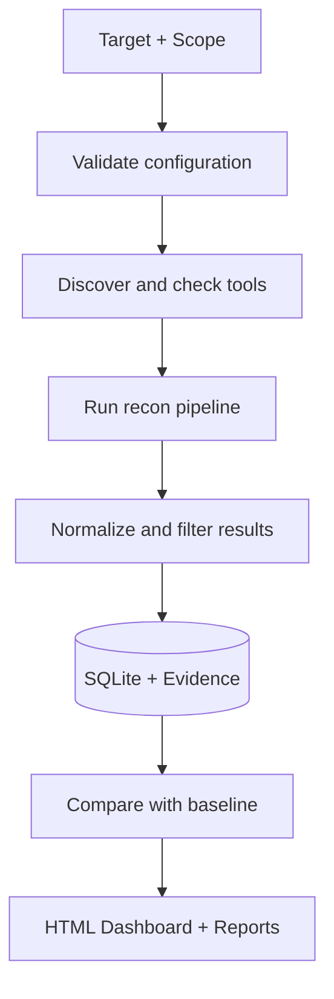

# ReconFlow

**One target. One workflow. A clear picture of your attack surface.**

ReconFlow is a Go-based reconnaissance orchestrator for authorized security testing. It connects existing recon tools into a dependency-aware pipeline, enforces scope rules, tracks findings across runs, and generates a self-contained HTML report.

Instead of manually chaining commands and comparing text files, use ReconFlow to organize your reconnaissance and understand what changed.

> **Early-stage software — v0.1.0.** Automated tests use mock tools. Real tool compatibility and Linux/Kali runtime behavior have not yet been validated. Review the limitations before relying on results.

---

## Why ReconFlow?

- **Automated workflow** — coordinate six established recon tools through one CLI.
- **Scope-aware collection** — filter observations against explicit allow and deny rules.
- **Change tracking** — compare successful runs and identify new or changed assets.
- **Evidence and provenance** — store observations, tool outputs, and execution history in SQLite.
- **JavaScript intelligence** — extract potentially interesting endpoints, parameters, GraphQL references, and WebSocket URLs.
- **Readable results** — generate structured exports and a standalone HTML dashboard that works offline.
- **Resumable runs** — use checkpoints to continue eligible interrupted or incomplete runs.

ReconFlow orchestrates existing tools; it is not a vulnerability scanner and does not confirm vulnerabilities.

## How it works



## Integrated tools

| Tool | Purpose |
|---|---|
| [Subfinder](https://github.com/projectdiscovery/subfinder) | Passive subdomain discovery |
| [dnsx](https://github.com/projectdiscovery/dnsx) | DNS resolution |
| [httpx](https://github.com/projectdiscovery/httpx) | HTTP service probing |
| [gau](https://github.com/lc/gau) | Historical URL discovery |
| [waybackurls](https://github.com/tomnomnom/waybackurls) | URLs from the Wayback Machine |
| [Katana](https://github.com/projectdiscovery/katana) | Web crawling |

These tools must be installed separately. ReconFlow checks whether their executables appear compatible with the flags it uses; this check has not yet been validated against real installed versions.

**Important:** ProjectDiscovery's `httpx` is required, not the Python package with the same command name.

## Installation

**Requirements**
- Linux (Kali is the intended runtime; Windows is currently a development platform).
- Go `1.27.0` or newer, as specified by `go.mod`.
- Any external recon tools you want to use.

Clone the repository, enter its root directory, and install:

```bash
git clone <YOUR-REPOSITORY-URL>
cd reconflow

./install.sh
```

The installer builds ReconFlow and installs it to `~/.local/bin/reconflow`. It does not install the external tools.

If `reconflow` is not found, add the installation directory to your `PATH`:

```bash
echo 'export PATH="$HOME/.local/bin:$PATH"' >> ~/.bashrc
source ~/.bashrc
```

Verify the installation:

```bash
reconflow --version
reconflow --help
reconflow tools
```

You can also build from source without installing:

```bash
go build -o reconflow ./cmd/reconflow
./reconflow tools
```

## Quick start

Use only a domain you own or are explicitly authorized to test. Replace `example.com` with your authorized target.

**1. Review the example files**

```bash
cat configs/config.example.yaml
cat configs/scope.example.yaml
```

**2. Validate your scope**

```bash
reconflow validate-scope \
  --scope configs/scope.example.yaml \
  -d example.com
```

Edit the example scope before using it on a real engagement. A validation failure must be resolved before proceeding.

**3. Start with passive reconnaissance**

```bash
reconflow -d example.com \
  --scope configs/scope.example.yaml \
  --passive
```

Passive mode runs the configured passive-capable stages. It does not intentionally probe the target directly, but it can query third-party data sources.

**4. Run the broader pipeline**

```bash
reconflow -d example.com \
  --scope configs/scope.example.yaml \
  --new
```

The broader pipeline may perform DNS queries, HTTP probes, crawling, and in-scope JavaScript downloads. Review your authorization and scope first.

**5. Open the report**

```bash
reconflow report -d example.com
```

Open `latest.html` from the target's reports directory in your browser. The dashboard is self-contained and works offline.

## What you get

ReconFlow stores its data under `~/.reconflow` by default.

| Output | What it contains |
|---|---|
| `latest.html` | Interactive offline dashboard |
| `latest.json` | Structured report |
| `execution.json` | Run, stage, tool, and error details |
| `coverage.json` | Comparison coverage and limitations |
| JSONL inventories | Machine-readable assets and URLs |
| Text change lists | New, changed, and not-seen items when a baseline exists |
| SQLite database | Historical observations, provenance, and run state |

The dashboard includes:

- Overview and run status
- Discovered assets and URLs
- JavaScript analysis leads
- API-related references
- Changes against a baseline
- Tool execution and errors
- Comparison coverage and report artifacts

ReconFlow distinguishes missing observations from confirmed removals. **It does not currently confirm that an asset has been removed.**

## Useful commands

| Command | Purpose |
|---|---|
| `reconflow --help` | Show CLI usage |
| `reconflow tools` | Check external tool availability |
| `reconflow validate-scope --scope scope.yaml -d example.com` | Validate scope |
| `reconflow -d example.com --passive` | Run passive-capable stages |
| `reconflow -d example.com --new` | Show new items after a run |
| `reconflow -d example.com --all` | Print the current inventory |
| `reconflow -d example.com --status` | Check the latest run status |
| `reconflow -d example.com --resume` | Resume an eligible incomplete run |
| `reconflow report -d example.com` | Regenerate reports without running recon tools |

For custom paths, rate limits, timeouts, and stage selection, start with `configs/config.example.yaml`.

## Scope and responsible use

ReconFlow uses a **default-deny** scope policy when an explicit scope file is provided. Exclusions take precedence over inclusions, and discovered data does not automatically expand the authorized scope.

Scope filtering is not a guarantee that every external tool will restrict all of its own DNS or network behavior. Review the scope, tool configuration, and program rules before each run.

- Test only assets you own or have explicit permission to assess.
- Respect program policies, rate limits, and third-party service terms.
- Treat JavaScript indicators as unverified leads, not vulnerabilities.
- Protect reports and databases, which may contain sensitive information.

## Project status and limitations

ReconFlow is under active development. The current implementation has automated tests built around mock tools, but the following remain unverified:

- Runtime behavior on Linux/Kali.
- Compatibility with real installed versions of all six external tools.
- End-to-end reconnaissance against an authorized real target.

Other current limitations:

- No integrated port scanner, TLS inventory tool, or vulnerability scanner.
- JavaScript analysis is regex-based; extracted indicators require manual verification.
- No live web dashboard or automatic data-retention/cleanup command.
- No confirmed asset-removal detection.

Treat early runs as trials and verify the results independently.

## Development

Run these commands from the repository root:

```bash
make fmt
make vet
make test
make build
```

The project is organized into packages for the CLI, configuration, scope validation, orchestration, scheduling, tool adapters, storage, comparison, JavaScript analysis, reporting, and terminal output.

See [`docs/IMPLEMENTATION.md`](docs/IMPLEMENTATION.md) for the implementation checklist and design notes.

## License

No license file is currently present. Until a license is added to the repository, do not assume that the code is licensed for redistribution or reuse.
